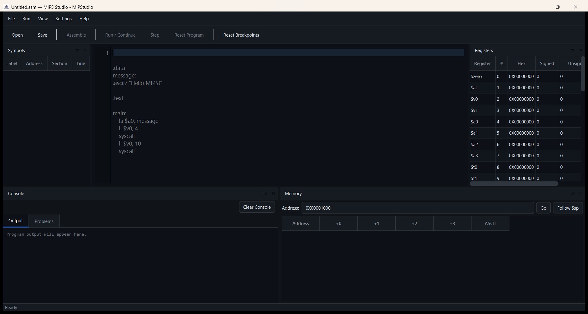
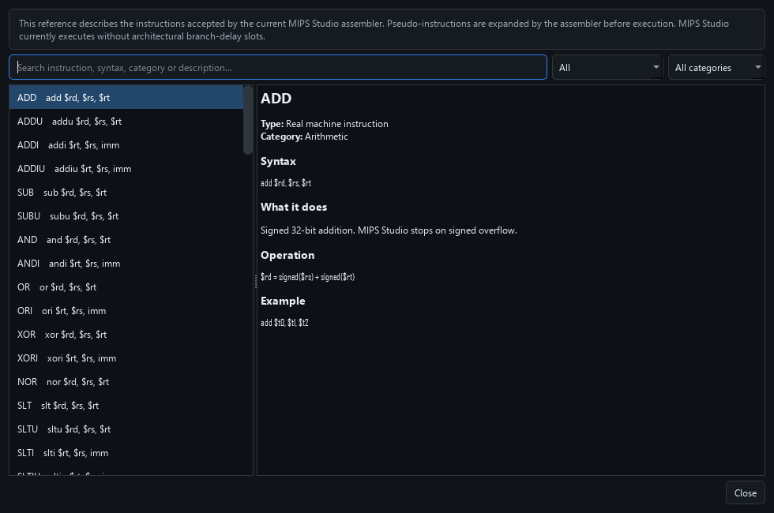
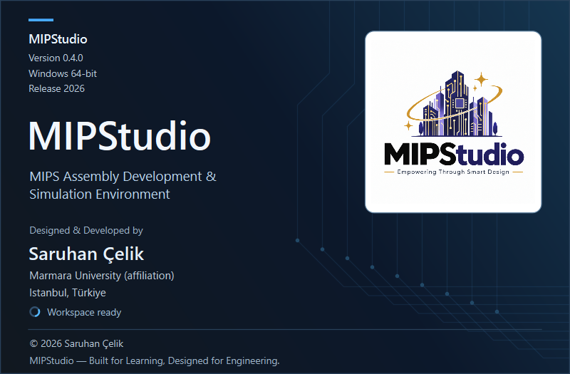

# MIPStudio

**MIPStudio** is a desktop development and simulation environment for learning and debugging **MIPS32 assembly language**. It combines a two-pass assembler, an instruction-level CPU emulator, a source editor, and an interactive debugger in a C++17 / Qt 6 Widgets application.

**Current project version:** `0.4.0` · **Windows build:** 64-bit, Qt 6 / MinGW · **Status:** project source and Windows distribution provided; not independently run in this repository preparation.



## Features

- **MIPS assembly editor** with syntax highlighting, source-level breakpoint markers, file open/save, and configurable appearance.
- **Two-pass assembler** with `.text` / `.data` support, labels, pseudo-instruction expansion, numeric operands, and error reporting.
- **MIPS32 emulator** with registers, PC, HI/LO, an ALU, and 64 KiB of byte-addressable, big-endian memory.
- **Interactive debugging:** assemble, run, step, reset, and breakpoints; disassembly and synchronized source mapping.
- **Inspector panels:** general-purpose registers, CPU state, memory, symbols, disassembly, and console/problems output.
- **Built-in instruction reference**, keyboard shortcuts, customizable themes and debugging/editor preferences.
- **Startup splash screen**, persisted workspace preferences, and a separate command-line debugging executable.
- **Assembly examples and regression tests** for the assembler and emulator.

> This is an educational MIPS32 implementation, **not** a guarantee of complete MIPS32 ISA, ABI, operating-system, or syscall compatibility. See the source and sample programs for implemented behavior.

## Download and run on Windows

1. Open this repository's **Releases** page.
2. Download **`MIPStudio-0.4.0-win64.zip`** (once the maintainer publishes it).
3. Extract the **entire archive** to a folder. Do not extract only `MIPStudio.exe`.
4. Run `MIPStudio.exe` from the extracted folder. Keep `Qt6*.dll`, the MinGW runtime DLLs, and the Qt plugin folders beside it.

No separate Qt installation is expected for the packaged Windows release. Windows may ask you to confirm running an unsigned application; only use builds you trust. No installer, auto-updater, or code signature is provided in the supplied files.

## Quick start

1. Launch **MIPStudio** and wait for the splash to finish.
2. Open a file from [`Assembly_Codes/`](Assembly_Codes/) (for example `IntegrationTest.asm`) or create a new `.asm` file.
3. Use **Assemble** to check and encode the source.
4. Use **Step** to execute individual instructions, or **Run** to continue execution.
5. Examine the registers, CPU state, memory, disassembly, and console; click the editor's breakpoint gutter to pause at selected source lines.
6. Use **Reset** to restart a debugging session.

For a fuller demo, see [`Assembly_Codes/UltimateIntegration.asm`](Assembly_Codes/UltimateIntegration.asm).

## Build from source

### Requirements

- C++17-capable compiler and **CMake >= 3.16**.
- **Qt 6** development libraries with **Widgets** and **Concurrent** components.
- For running the optional startup regression suite: the matching **Qt Test** component.
- On Windows, the checked-in `CMakePresets.json` targets **Qt 6.11.2**, **MinGW 13.1 64-bit**, and Ninja installed under `C:/Qt/...`. Adjust your local Qt paths or use the generic CMake commands below.

### Portable CMake commands

```sh
cmake -S . -B build-local -DCMAKE_PREFIX_PATH="/path/to/Qt/6.x/<your-kit>"
cmake --build build-local --config Release
```

On Windows, point `CMAKE_PREFIX_PATH` to the Qt installation matching the selected compiler. The GUI target is **`mips_gui`**, whose actual executable name is **`MIPStudio.exe`** on Windows. The console debugger target is **`mips_cli`**. A source build normally needs Qt's runtime environment; the packaged release includes deployed Windows dependencies.

### Windows / Qt Creator preset

```powershell
cmake --preset release
cmake --build --preset release
```

These presets work **as supplied only if** your Qt installation matches the paths and toolchain recorded in `CMakePresets.json`. You can alternatively open `CMakeLists.txt` in Qt Creator and choose a compatible Qt 6 Desktop kit.

## Run tests

The optional tests are disabled by default in generic builds. Enable them when configuring:

```sh
cmake -S . -B build-tests -DCMAKE_PREFIX_PATH="/path/to/Qt/6.x/<your-kit>" -DMIPSTUDIO_BUILD_STARTUP_TESTS=ON
cmake --build build-tests
ctest --test-dir build-tests --output-on-failure
```

The checked-in Windows `debug` preset also enables tests:

```powershell
cmake --preset debug
cmake --build --preset debug
ctest --preset debug
```

The UI startup test is configured to use Qt's offscreen platform plugin. Some systems still require a correctly installed Qt platform plugin and font setup.

## Codebase overview

| Path | Purpose |
| --- | --- |
| `src/`, `include/` | CPU, memory, ALU, assembler, emulator session, debugger, GUI |
| `src/gui_main.cpp` | Desktop GUI entry point |
| `src/main.cpp` | CLI debugger entry point |
| `Assembly_Codes/` | Assembly demonstrations and assembler error fixtures |
| `tests/` | C++ regression and startup tests |
| `assets/`, `resources.qrc`, `resources/` | Application branding and embedded Qt resources |
| `tools/` | Windows icon generation and startup verification scripts |
| `docs/STARTUP.md` | Detailed startup/release verification engineering notes |
| `docs/RELEASING.md` | Packaging and publishing a Windows GitHub release |

## Screenshots





## Limitations and contributions

This repository has not been cross-platform runtime-tested as part of its GitHub preparation. The supplied release is a **Windows x64** distribution. Bug reports should include OS version, input `.asm` file, steps to reproduce, and observed/expected behavior. See [CONTRIBUTING.md](CONTRIBUTING.md).

## License

**A public-use/open-source license has not yet been selected for this prepared repository.** Before publishing, choose and add a `LICENSE` file with terms you are entitled to grant. See [`LICENSE-CHOICE.md`](LICENSE-CHOICE.md). Without one, copyright applies by default and contributors cannot assume permission to redistribute or modify the source.
